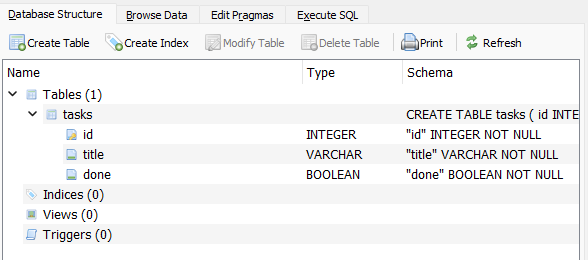
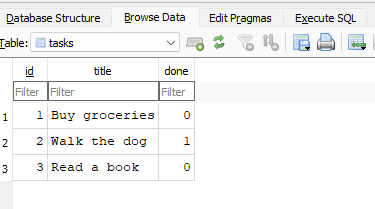
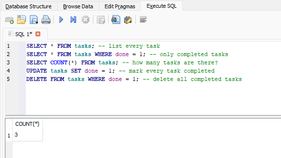
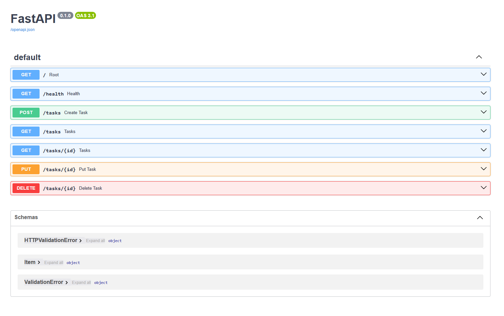

# Task API

A simple FastAPI CRUD API for managing tasks. This API allows you to create, read, update, and delete tasks with support for filtering by search terms and completion status.

## Why SQLite?

This project uses SQLite because it is:

- a single database file
- zero setup required
- easy to inspect and debug locally
- persistent across restarts without needing a separate database server

SQLite is a good fit for this assignment because it keeps the project lightweight while still letting the app store task data reliably between runs.

## Database Location

The app stores its data in a local SQLite database file named `tasks.db`.

- The file is created automatically on first run.
- It stays on disk between restarts, so the task data survives app restarts.

## Quick Start

Install dependencies and run the server with one command:

```bash
bash start.sh
```

The API will be available at `http://localhost:8000` with interactive API documentation at `http://localhost:8000/docs`.

## Database Implementation

### DB Browser




### DB Browser Query



## OpenAPI Documentation



## API Endpoints

| Method | Endpoint | Description |
|--------|----------|-------------|
| `GET` | `/` | API information and available endpoints |
| `GET` | `/health` | Health check |
| `GET` | `/tasks` | List all tasks (supports `search` and `done` query parameters) |
| `GET` | `/tasks/{id}` | Get a specific task by ID |
| `POST` | `/tasks` | Create a new task |
| `PUT` | `/tasks/{id}` | Update a task (partial updates supported) |
| `DELETE` | `/tasks/{id}` | Delete a task |

## Example curl Output

```
HTTP/1.1 200 OK
date: Sun, 26 Jul 2026 14:48:40 GMT
server: uvicorn
content-length: 135
content-type: application/json

[{"id":1,"title":"Buy groceries","done":false},{"id":2,"title":"Walk the dog","done":true},{"id":3,"title":"Read a book","done":false}]
```

## Usage Examples

### Get all tasks
```bash
curl http://localhost:8000/tasks
```

### Filter by completion status
```bash
curl "http://localhost:8000/tasks?done=true"
```

### Search tasks
```bash
curl "http://localhost:8000/tasks?search=book"
```

### Get a specific task
```bash
curl http://localhost:8000/tasks/1
```

### Create a new task
```bash
curl -X POST http://localhost:8000/tasks \
  -H "Content-Type: application/json" \
  -d '{"title": "Buy milk"}'
```

### Update a task
```bash
curl -X PUT http://localhost:8000/tasks/1 \
  -H "Content-Type: application/json" \
  -d '{"done": true}'
```

### Delete a task
```bash
curl -X DELETE http://localhost:8000/tasks/1
```

---
<br/>
<center><b>Note:</b> This is a Flyranks assignment for Backend AI Engineering.</center>