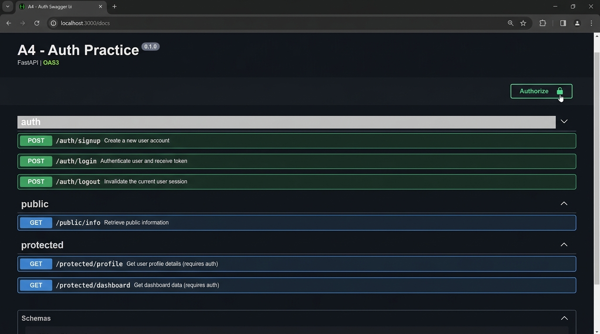

# Auth Practice

A backend authentication service built with **FastAPI** and **Supabase Auth**. This project demonstrates implementing user authentication workflows (sign up, log in, log out) and route authorization through FastAPI's **dependency injection** system (`Depends`), securing protected endpoints using `HTTPBearer` token verification.

The repository follows standard Python project structure and modern package management initialized using **`uv init`** (`pyproject.toml` with `src/` layout).

## Quick Start

### 1. Environment Setup

Copy the example environment file and configure your Supabase credentials:

```bash
cp .env.example .env
```

Ensure your `.env` contains:
```env
SUPABASE_URL=https://<your-project-id>.supabase.co
SUPABASE_KEY=eyJhbGciOi...<your-supabase-anon-or-service-key>
PORT=3000
```

### 2. Run the Application
> The API will be available at **[http://localhost:3000/](http://localhost:3000/)**
#### With `uv` (Recommended):

```bash
uv run fastapi dev main.py
```

#### Without `uv`
```bash
# Setting up with venv is recommended.
pip install -e && fastapi dev main.py
```

## API Reference

> Once the server is running, the interactive Swagger UI documentation is accessible at: **[http://localhost:3000/docs](http://localhost:3000/docs)**

### Endpoints Summary

| Method | Endpoint | Auth Required | Description | Request Body / Header | Status Code |
| :--- | :--- | :--- | :--- | :--- | :--- |
| `POST` | `/auth/signup` | No | Register a new user | JSON: `{ "email": "...", "password": "..." }` | `201 Created` |
| `POST` | `/auth/login` | No | Authenticate user & receive session token | JSON: `{ "email": "...", "password": "..." }` | `200 OK` |
| `POST` | `/auth/logout` | Yes (`Bearer`) | Sign out current user session | Header: `Authorization: Bearer <token>` | `204 No Content` |
| `GET` | `/public/info` | No | Public welcome message endpoint | None | `200 OK` |
| `GET` | `/protected/profile` | Yes (`Bearer`) | Retrieve current user profile (`id`, `email`, `created_at`) | Header: `Authorization: Bearer <token>` | `200 OK` |
| `GET` | `/protected/dashboard` | Yes (`Bearer`) | Retrieve authenticated user dashboard data | Header: `Authorization: Bearer <token>` | `200 OK` |

---
<br/>
<center><b>Note:</b> This is a Flyranks assignment for Backend AI Engineering.</center>
